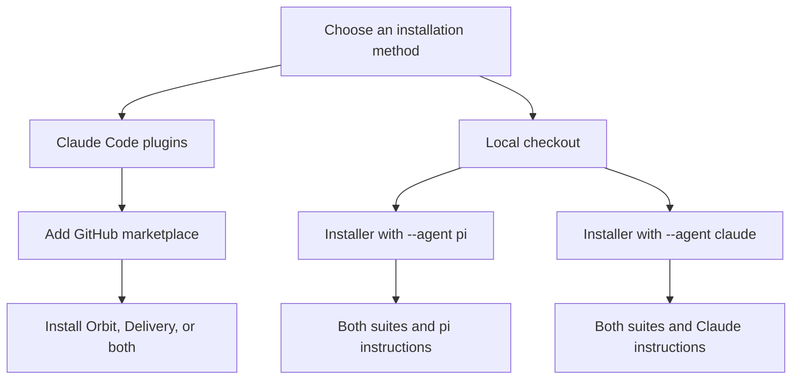
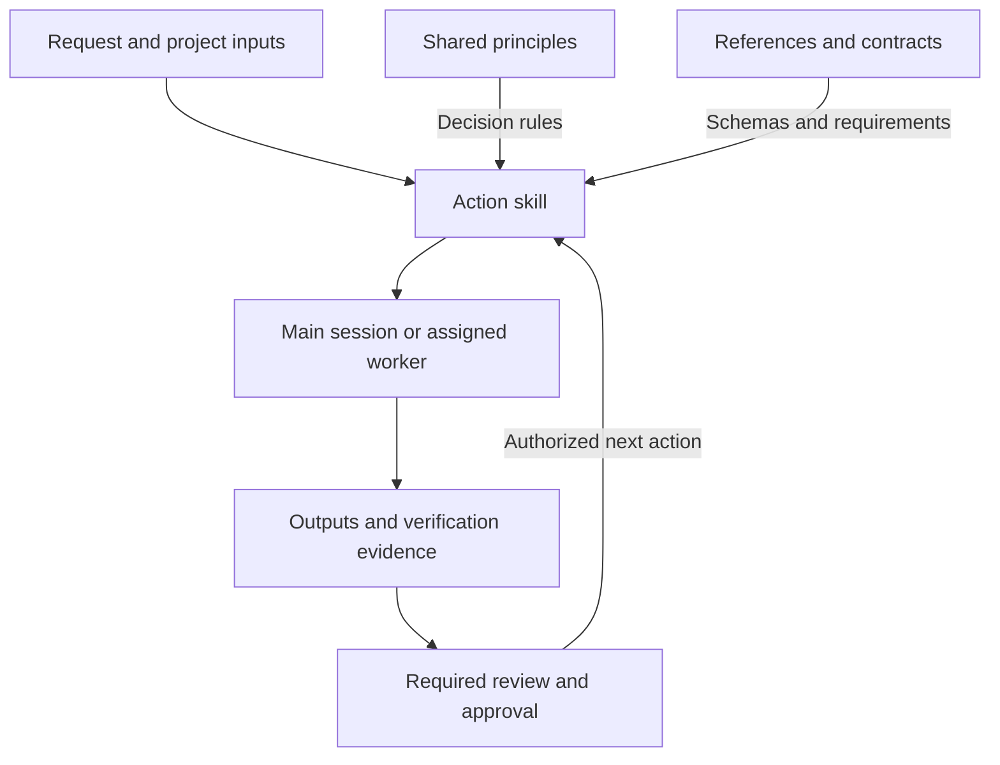

# agent-skills

Reusable skills for Claude Code and pi. Choose Orbit for effort estimation or
Delivery for software changes. Claude plugins install independently. The local
installer registers both suites and personal instructions for the selected agent.

## Choose a suite

| Suite | Use it for | Contents |
|---|---|---|
| [orbit-cost-estimate](#orbit-planning-skills) | Scope, effort, staffing, schedule, and risk. Produces planning artifacts and workbooks, not financial prices | 1 router, 12 actions, 8 principles |
| [delivery](#software-delivery-skills) | Requirements, design, implementation, debugging, review, and release qualification | 11 actions, 4 principles, 2 optional execution profiles |

## Install

Install and authenticate Claude Code or pi separately. This repository does not
manage credentials, model selection, hooks, or MCP servers. Neither installation
method requires npm publishing.



Choose one Claude installation method for each suite. Installing both direct
resources and plugins loads unprefixed and namespaced copies of the same skills.
Pi can use the checkout alongside Claude plugins.

### Install Claude plugins

Run these commands in your terminal. Install either plugin or both:

```sh
claude plugin marketplace add nixbpe/agent-skills
claude plugin install orbit-cost-estimate@nixbpe-agent-skills
claude plugin install delivery@nixbpe-agent-skills
claude plugin list
```

Installation defaults to user scope. Add `--scope project` or `--scope local` to a
plugin-install command for a project-specific installation. Start a new Claude
Code session after installation.

Plugins do not install personal instructions, shared rules, root `commands/`, or
pi resources. They do not change global instruction files.

To load a local checkout instead of GitHub, use the same install commands after:

```sh
claude plugin marketplace add /absolute/path/to/agent-skills
```

The path must contain `.claude-plugin/marketplace.json`. Choose either the remote
or local source for the marketplace name `nixbpe-agent-skills`.

<a id="install-directly-for-claude-or-pi"></a>

### Pi

The repository installer requires Python 3.9 or newer and no Python dependencies.
Clone the repository, then register it for pi:

```sh
git clone https://github.com/nixbpe/agent-skills.git
cd agent-skills
python3 scripts/setup.py check --source-only
python3 scripts/setup.py install --agent pi --dry-run
python3 scripts/setup.py install --agent pi
python3 scripts/setup.py check --agent pi
```

Start a fresh pi session. The installer adds the checkout to `packages` in
`~/.pi/agent/settings.json` and writes personal instructions and shared rules to
`~/.pi/agent/AGENTS.md`. It does not invoke pi, install dependencies, or create
skill symlinks. Keep the checkout in place while installed.

### Direct Claude installation

Use this method when you want local symlinks and personal instructions instead
of plugins. Do not use it alongside plugins for the same suites.

From a checkout created as above, run:

```sh
python3 scripts/setup.py check --source-only
python3 scripts/setup.py install --agent claude --dry-run
python3 scripts/setup.py install --agent claude
python3 scripts/setup.py check --agent claude
```

The installer links both suites, Claude profiles, and any root commands. It
combines `instructions/personal.md` and `rules/*.md` into `~/.claude/CLAUDE.md`.
There is no instructions-only mode. Start a new Claude Code session.

Without `--agent`, installer commands target both Claude and pi. Use `--home`
with a different home directory for a sandbox. The installer uses standard
config locations and ignores `CLAUDE_CONFIG_DIR` and `PI_CODING_AGENT_DIR`.

### Switch from direct Claude installation

Do not keep a suite installed both directly and as a plugin. The unprefixed and
namespaced copies can both be discovered. Before switching, inspect the
installer's removal plan from the checkout that owns the direct installation:

```sh
python3 scripts/setup.py uninstall --agent claude --dry-run
python3 scripts/setup.py uninstall --agent claude
```

This removes only installer-owned Claude resources. It removes both directly
installed suites, their profiles, any owned commands, and the generated global
`~/.claude/CLAUDE.md`. It does not remove pi resources or unmanaged files.
Preserve any personal instructions you still need before uninstalling, then
manage those instructions separately from the plugins. If ownership checks
report modified files, preserve your edits and resolve the conflict first.
Do not delete unmanaged skills, agents, or instruction files to force migration.

After uninstalling the direct resources, install the plugin or plugins you
want. The installer does not manage plugin installations.

## Use the skills

| Installation | Orbit router | Delivery debugging |
|---|---|---|
| Claude plugin | `/orbit-cost-estimate:orbit-cost-estimate` | `/delivery:delivery-debug` |
| Direct Claude | `/orbit-cost-estimate` | `/delivery-debug` |
| pi | `/skill:orbit-cost-estimate` | `/skill:delivery-debug` |

Replace the final skill name to invoke another action. Keep the plugin namespace
when using a Claude plugin. Project inputs and `output/` belong to the working
project. Bundled references and scripts resolve from the installed skill directory.



This diagram shows responsibilities, not a mandatory sequence of every skill.
The runtime executes the work. Skills provide instructions and cannot create
subagents or enforce permissions by themselves. An action stops at its own
boundary unless further work is authorized.

### Orbit planning skills

Start with [Orbit cost estimate](plugins/orbit-cost-estimate/skills/orbit-cost-estimate/SKILL.md). The guide
is written in Thai for people who prepare and review estimates. It explains
which action to choose, what inputs it needs and where each result is written.
The suite plans scope, effort, duration, resources and risk. It does not
calculate financial costs, rate cards or selling prices.

#### Reading order

1. Open the workflow guide to choose an action.
2. Read that action's `SKILL.md` for prerequisites, steps, outputs and stop rules.
3. Read its linked principles for shared decisions.
4. Open `references/contract.md` for the complete schema, formulas and templates.

The short guides use the same six sections: when to use the action, required
inputs, required rules, workflow, outputs and stop conditions, and an example
request. Technical terms, artifact names, IDs and contract headings retain
their original spelling.

#### Choose an action

| Goal | Skill | Planning artifact |
|---|---|---|
| Analyze a TOR or RFP | [orbit-analyze-tor](plugins/orbit-cost-estimate/skills/orbit-analyze-tor/SKILL.md) | Step 00 |
| Define intake and scope | [orbit-define-scope](plugins/orbit-cost-estimate/skills/orbit-define-scope/SKILL.md) | Step 01 |
| Design architecture and constraints | [orbit-design-architecture](plugins/orbit-cost-estimate/skills/orbit-design-architecture/SKILL.md) | Step 02 |
| Inventory functional features | [orbit-inventory-features](plugins/orbit-cost-estimate/skills/orbit-inventory-features/SKILL.md) | Step 03.1 |
| Build backlog and screen/API inventory | [orbit-build-backlog](plugins/orbit-cost-estimate/skills/orbit-build-backlog/SKILL.md) | Step 03.2 |
| Build work packages and ownership | [orbit-build-wbs](plugins/orbit-cost-estimate/skills/orbit-build-wbs/SKILL.md) | Step 03.3 |
| Estimate raw effort and review it | [orbit-size-effort](plugins/orbit-cost-estimate/skills/orbit-size-effort/SKILL.md) | Step 04 Estimate and Review |
| Plan staffing, capacity and schedule | [orbit-plan-resources](plugins/orbit-cost-estimate/skills/orbit-plan-resources/SKILL.md) | Step 05 |
| Assess risk and finalize planning | [orbit-assess-risk](plugins/orbit-cost-estimate/skills/orbit-assess-risk/SKILL.md) | Step 06 |
| Prepare a workbook for review | [orbit-prepare-workbook](plugins/orbit-cost-estimate/skills/orbit-prepare-workbook/SKILL.md) | Workbook Markdown |
| Export a reviewed workbook | [orbit-export-workbook](plugins/orbit-cost-estimate/skills/orbit-export-workbook/SKILL.md) | XLSX |
| Draw an approved architecture | [orbit-draw-architecture](plugins/orbit-cost-estimate/skills/orbit-draw-architecture/SKILL.md) | SVG and PNG |

Actions can run directly when their approved input artifacts are available.
They do not require invoking the router first. Install all 21 skills together
because actions load shared principles and references from sibling directories.
Do not copy a single `SKILL.md` without its dependencies.

Each action stops after its own output. The router advances the planning
workflow only under the recorded authorization and after quality gates pass.
Preparing workbook Markdown and exporting XLSX have a separate review gate.
Architecture diagrams need approved architecture, not a completed Step 06.

#### Invoke a skill

Select `orbit-size-effort`, then give it a bounded request:

> ใช้ approved artifacts ใน output/ ประเมิน Raw MD แล้วส่ง Estimate และ Review
> เป็นคู่ให้ตรวจ อย่าทำ resource planning ต่อ

### Software delivery skills

Use `delivery-*` for software requirements, design, implementation, review, and
release qualification. These skills use the working project's contracts and
commands. They do not require a particular stack, review vendor, or planning
hierarchy.

#### Choose a delivery action

| Goal | Skill | Result |
|---|---|---|
| Define product scope and criteria | [delivery-define-work](plugins/delivery/skills/delivery-define-work/SKILL.md) | Accepted decisions, proposals, and observable criteria |
| Resolve shared technical contracts | [delivery-design-solution](plugins/delivery/skills/delivery-design-solution/SKILL.md) | Changed contracts and bounded tasks |
| Design UI flows and states | [delivery-design-experience](plugins/delivery/skills/delivery-design-experience/SKILL.md) | Flow, state, and accessibility requirements |
| Implement one authorized change | [delivery-implement-change](plugins/delivery/skills/delivery-implement-change/SKILL.md) | Changed behavior and author-produced proof |
| Diagnose and repair a failure | [delivery-debug](plugins/delivery/skills/delivery-debug/SKILL.md) | Causal diagnosis, repair, and regression proof |
| Review source and supplied evidence | [delivery-review-change](plugins/delivery/skills/delivery-review-change/SKILL.md) | Static findings and a recommendation |
| Assess security boundaries | [delivery-secure-boundaries](plugins/delivery/skills/delivery-secure-boundaries/SKILL.md) | Threats, controls, and coverage gaps |
| Assign and integrate owned work | [delivery-coordinate-work](plugins/delivery/skills/delivery-coordinate-work/SKILL.md) | Coordinated handoffs and integration evidence |
| Deliver a requested change as a PR | [delivery-deliver-change](plugins/delivery/skills/delivery-deliver-change/SKILL.md) | An unmerged PR after authorized publication and verification |
| Resolve an existing PR's findings | [delivery-review-pr](plugins/delivery/skills/delivery-review-pr/SKILL.md) | Head-specific evidence and bounded repair results |
| Qualify a merge-ready release candidate | [delivery-qualify-release](plugins/delivery/skills/delivery-qualify-release/SKILL.md) | A source-bound readiness verdict, without deployment |

Invoke an action directly when its inputs are available. No router or complete
planning sequence is required. For debugging, supply the failure evidence,
affected project, and authorized repair scope:

> Reproduce the checkout failure, identify its cause, and fix the authorized
> code path. Show failing-before and passing-after evidence. Do not publish.

For implementation, provide accepted criteria and write ownership. For review,
provide the candidate identity, diff, and existing verification evidence.

Each action lists its inputs, required reading, steps, verification, and stop
conditions. Follow links relative to the document that contains them. Keep all
15 delivery skills installed together so their dependencies resolve.

#### Apply shared principles

| Principle | Decision it governs |
|---|---|
| [principle-delivery-authority](plugins/delivery/skills/principle-delivery-authority/SKILL.md) | Scope, role limits, and separate publication permissions |
| [principle-delivery-owned-writes](plugins/delivery/skills/principle-delivery-owned-writes/SKILL.md) | File ownership, shared resources, transfer, and stopping writers |
| [principle-delivery-source-evidence](plugins/delivery/skills/principle-delivery-source-evidence/SKILL.md) | Verification status, independent review, severity mapping, and candidate identity |
| [principle-delivery-trust-boundaries](plugins/delivery/skills/principle-delivery-trust-boundaries/SKILL.md) | Untrusted input, access control, credentials, and destructive operations |

Use the [project context contract](plugins/delivery/skills/delivery-coordinate-work/references/project-context.md)
to locate project-specific facts in existing instructions, scripts, and accepted
sources. Do not create a new configuration file just to use a skill.

Ordinary implementation needs no release manifest. Release qualification binds
`candidateId`, `acceptanceVersion`, and `manifestDigest` to immutable source and
accepted criteria. PR-only work can use a source identity such as `PR-42-C1`.
Review findings retain their source severity and use the project's blocking
mapping. Unknown mappings remain unresolved.

#### Adopt the suite in a project

Install the suite without deleting existing project instructions. Map the
project's commands, review policy, roles, and release identifiers to the shared
contracts. Preserve any stricter project restrictions.

Check skill discovery and effective worker and reviewer tools in each runtime.
Exercise a bounded implementation, a read-only review, and a failed release gate
before removing replaced project definitions. Verify that existing review and
publication requirements still hold. This repository does not migrate another
project or modify its settings during installation.

### Optional execution profiles

#### Choose an execution profile

The main session coordinates work. It can implement a small change when project
policy permits. Use a separate worker for role restrictions or independent
ownership. Use a separate reviewer when independent review is required.

| Profile | Tools and responsibility | Limits |
|---|---|---|
| `delivery-worker` | Reads, edits, and executes assigned checks | No implicit publication, production access, or child delegation |
| `delivery-reviewer` | Reads source and supplied evidence | No command execution, file edits, repairs, or release approval |

The coordinator supplies resolved skill paths, accepted criteria, ownership,
verification scope, and authorization through the
[assignment contract](plugins/delivery/skills/delivery-coordinate-work/references/assignment-and-handoff.md).
For a reviewer, it also supplies diffs and Git metadata collected by an
authorized inspection owner. No profile hardcodes a model.

The delivery plugin exposes these profiles as `delivery:delivery-worker` and
`delivery:delivery-reviewer`. Direct Claude installation links the definitions
from `plugins/delivery/agents/` and keeps the unprefixed names in the table.
pi profiles keep those unprefixed names and are exposed by the
`pi-subagents.agents` field in `package.json`. To use them, install the optional
extension in your pi environment:

```sh
pi install npm:pi-subagents
```

Register this checkout with the repository installer, then start a fresh pi
session. The extension discovers the two definitions under `pi/agents/`.
Existing same-name project or user profiles can take precedence. Inspect the
effective definition before relying on its tools. The installer does not install
the extension or change model overrides.

The skills work without subagents for procedures that permit one actor.
Self-review does not satisfy independent review. Tool lists constrain available
operations, but they do not isolate files, credentials, or environments. Keep
mandatory permissions in runtime configuration or always-on project instructions.

## Runtime requirements

Install the extra tools only for actions that need them. Planning and review do
not require every workbook or diagram dependency.

### Optional runtime requirements

| Action | Requirement |
|---|---|
| TOR analysis with non-text input | Docling conversion under the action's source-quality contract |
| Workbook export | Python 3.10+ and the bundled [requirements.txt](plugins/orbit-cost-estimate/skills/orbit-export-workbook/scripts/requirements.txt), installed in a suitable environment |
| Workbook recalculation | Excel or LibreOffice; otherwise report `Not recalculated` |
| Workbook layout | Noto Sans Thai, or an installed Thai-capable font selected with `defaults.font_name`; inspect the rendered workbook before delivery |
| Diagram generation | A project-local SVG renderer and an SVG viewer; `rsvg-convert` for PNG export |

The workbook converter is bundled with the export skill. Always pass an
explicit project config with source-derived phase bands. The diagram skill
guides creation of a project-local renderer from approved nodes and edges.

After recalculation, verify the actual XLSX against its Markdown and config:

```sh
python plugins/orbit-cost-estimate/skills/orbit-export-workbook/scripts/verify_workbook.py \
  --input output/estimation_workbook.md \
  --workbook output/estimation_workbook.xlsx \
  --config output/workbook_config.yaml \
  --output output/workbook_verification.json
```

Exit codes are `0` for `Pass`, `1` for `Warning`, `2` for `Fail`, and `3` for
input or runtime errors. The verifier independently checks supported arithmetic,
identifiers, formula transfer and warning disclosure. It does not calculate
formulas or establish whether source scope, actors or approvals are correct.
Missing formula caches remain unresolved. Review those limits alongside the
generated findings.

The verifier command above uses a repository-relative script path. With a Claude
plugin, resolve the bundled script from the installed `orbit-export-workbook`
skill directory and pass your project's input, config, and output paths.

## Update and uninstall

### Update or remove plugins

Update only the plugins you installed:

```sh
claude plugin marketplace update nixbpe-agent-skills
claude plugin update orbit-cost-estimate@nixbpe-agent-skills
claude plugin update delivery@nixbpe-agent-skills
```

Start a new Claude Code session. Remote installations use cached plugin copies.
A local marketplace can load plugins in place, depending on the Claude Code
version. Editing a checkout does not necessarily update a cached installation.

Remove a plugin with its matching command:

```sh
claude plugin uninstall orbit-cost-estimate@nixbpe-agent-skills
claude plugin uninstall delivery@nixbpe-agent-skills
```

The repository installer does not manage plugin installations.

### Update

For checkout-based installations, pull changes from the installed checkout, then
rerun the installer. For pi:

```sh
git pull --ff-only
python3 scripts/setup.py install --agent pi
python3 scripts/setup.py check --agent pi
```

Use `--agent claude` for direct Claude installations. Omit `--agent` only when
you intend to update both agents.

Existing linked resources reflect edits directly. Rerun installation to add or
remove Claude links and regenerate personal instructions. Restart Claude Code
or start a fresh pi session after updating resources.

Keep the checkout in place while it is installed. Before moving it, uninstall
from the original location, move it, then install again.

### Uninstall

Run from the checkout that owns the installation. For pi:

```sh
python3 scripts/setup.py uninstall --agent pi --dry-run
python3 scripts/setup.py uninstall --agent pi
```

Use `--agent claude` for direct Claude installations and the same `--home` value
used at install time. Uninstall removes owned files, links, and the pi package
declaration. It leaves unrelated resources, settings, and empty directories.

## Troubleshooting

| Symptom | Check |
|---|---|
| A plugin skill is missing | Run `claude plugin list`, check that the plugin is enabled, and start a new session. Use the plugin namespace |
| A direct-install skill is missing | Run `python3 scripts/setup.py check --agent claude` or `--agent pi` from the owning checkout, then start a new session |
| Both namespaced and unprefixed copies appear | Follow [Switch from direct Claude installation](#switch-from-direct-claude-installation) |
| Links broke after moving the checkout | Restore the original location, uninstall there, then move and reinstall |
| The agent uses a custom config directory | The direct installer uses standard config locations. Use the agents' standard locations with this installer |

`check` validates installed resources and ownership, not model authentication or
agent behavior. Invoke a skill in a working project to verify runtime discovery.

### Conflict handling

The installer checks both selected agents before writing anything. An existing
destination without an ownership record is a conflict, even if its contents
match. A pi package entry registered outside this installer is also a conflict.
Resolve the reported destination manually, then rerun the command.

Ownership records live in `~/.local/state/agent-skills/claude.json` and
`~/.local/state/agent-skills/pi.json`. Do not delete these while resources remain
installed. They identify the checkout, generated file hashes and symlink targets.

Edit personal instructions in this checkout, rather than editing generated
files. If a managed file or package filter changes outside the installer,
update and uninstall stop without changing it. Back up your edits and restore
the managed version before retrying.

The installer preserves unrelated pi settings and package entries, but
rewrites the settings file as formatted JSON when its package entry changes.
Symlinked config directories and JSON files are rejected. Stop agents and
other config editors while installing: writes are atomic per JSON or text
file, but the whole installation is not a transaction.

Keep API keys, tokens, sessions and machine-specific settings outside this
repository. Login through each agent separately.

## Maintain this repository

### Layout

| Path | Purpose | Installed destination |
|------|---------|-----------------------|
| `AGENTS.md` | Instructions for maintaining this repository | Not installed |
| `CLAUDE.md` | Symlink to `AGENTS.md` for this repository | Not installed |
| `instructions/personal.md` | Personal instructions for every project | Combined with rules into each agent's global instruction file |
| `rules/*.md` | Shared rules, included in filename order | Included in the generated instructions |
| `.claude-plugin/marketplace.json` | Catalog named `nixbpe-agent-skills` | Registered with Claude's plugin manager |
| `plugins/orbit-cost-estimate/` | Orbit plugin manifest and all 21 skills | Claude plugin manager |
| `plugins/delivery/` | Delivery plugin manifest, 15 skills, and two Claude profiles | Claude plugin manager |
| `plugins/*/skills/<name>/SKILL.md` | Canonical shared skills | Claude plugin resources or direct symlinks; pi package resources |
| `commands/*.md` | Direct-install Claude slash commands | `~/.claude/commands/<name>.md` |
| `plugins/delivery/agents/*.md` | Claude subagent definitions | Delivery plugin resources or direct links in `~/.claude/agents/` |
| `pi/prompts/*.md` | pi prompt templates | Loaded through the pi package |
| `pi/agents/*.md` | pi subagent definitions | Discovered from this package by the optional `pi-subagents` extension |
| `package.json` | Private pi package manifest | Registered by absolute checkout path |
| `scripts/setup.py` | Install, uninstall and check commands | Run from this checkout |
| `tests/test_setup.py` | Installer safety regressions | Run locally |

Both runtime paths share the resources under `plugins/`. `pi.skills` lists both
plugin skill directories. `pi.prompts` loads `./pi/prompts/*.md`, and
`pi-subagents.agents` lists `./pi/agents`. Commands and pi prompt templates are
currently empty because actions are invoked as skills.

### Add resources

#### Shared skills

Add `plugins/orbit-cost-estimate/skills/<name>/SKILL.md` for an Orbit skill or
`plugins/delivery/skills/<name>/SKILL.md` for a delivery skill.
Include YAML frontmatter with `name` and `description`, followed by the
instructions. Use a lowercase kebab-case name matching the directory, with at
most 64 characters.

This repository's checker requires nonempty, single-line `name` and
`description` values. It checks those fields rather than implementing a full
YAML validator. Optional `scripts/` and `references/` directories belong inside
the skill directory. Keep tool names and instructions portable across agents.

Keep each suite's skills, shared principles, scripts, and references inside its
plugin directory. These are the canonical sources for plugins, the direct
installer, and pi. Do not generate duplicate bundles or link outside a plugin
root. Sibling references must remain valid when Claude copies a plugin into its
cache.

#### Agent-specific resources

- Put direct-install Claude slash commands in `commands/*.md`. These are not bundled in either plugin.
- Put Claude delivery subagent definitions in `plugins/delivery/agents/*.md`.
- Put pi subagent definitions in `pi/agents/*.md`. Install `pi-subagents` to load them through this package's manifest.
- Put pi prompt templates in `pi/prompts/*.md`; invoke them as `/<name>`.

Claude commands are not automatically converted into pi prompts. Claude's
`plugins/delivery/agents/` directory is not installed into pi. Use native tool
names in each runtime's definitions and inspect the effective profile after
registration.

#### Maintain the suite

Shared policy lives in `principle-orbit-*`. Each action owns its detailed
contract. The router owns selection and sequencing, not duplicate formulas.
Optional architecture profiles are references to evaluate, not required stacks.

### Verify

Validate the marketplace and each plugin with Claude Code:

```sh
claude plugin validate --strict .
claude plugin validate --strict plugins/orbit-cost-estimate
claude plugin validate --strict plugins/delivery
```

Run the installer and workbook regressions:

```sh
python3 -m venv .venv
.venv/bin/python -m pip install -r plugins/orbit-cost-estimate/skills/orbit-export-workbook/scripts/requirements.txt
.venv/bin/python -B -m unittest discover -s tests -v
.venv/bin/python scripts/setup.py check --source-only
```

The tests use disposable checkouts and home directories. They cover dry-run,
repeat installation, conflicts across agents, modified managed files, stale
links, settings preservation, package ownership and symlinked config paths.
Workbook tests cover identifier preservation, independent arithmetic, cached
formula values and disclosure of unresolved findings.

To exercise the installer without changing your actual configuration:

```sh
sandbox="$(mktemp -d)"
python3 scripts/setup.py install --home "$sandbox"
python3 scripts/setup.py check --home "$sandbox"
PI_CODING_AGENT_DIR="$sandbox/.pi/agent" pi list
python3 scripts/setup.py uninstall --home "$sandbox"
```

The sandbox remains available for inspection; remove it when finished.
`check` validates installed resources and ownership, not model authentication
or agent behavior. After installing real skills, open an unrelated project and
invoke one in each agent to verify discovery and execution.

### Publish plugin updates

Increase the affected plugin's `version` in its `.claude-plugin/plugin.json`
before publishing an update. Validate the marketplace and both plugins, then
commit and push the manifests and their resources together. GitHub installation
uses the published repository, not uncommitted changes in your checkout.

## References

- [Claude Code instructions and rules](https://code.claude.com/docs/en/memory)
- [Claude Code skills](https://code.claude.com/docs/en/skills)
- [Claude Code plugins](https://code.claude.com/docs/en/plugins/overview.md)
- [Install and manage Claude Code plugins](https://code.claude.com/docs/en/plugins/install.md)
- [pi packages](https://github.com/earendil-works/pi/blob/main/packages/coding-agent/docs/packages.md)
- [pi skills](https://github.com/earendil-works/pi/blob/main/packages/coding-agent/docs/skills.md)

## License

MIT. See [LICENSE](LICENSE). Use, copy and modify freely.
